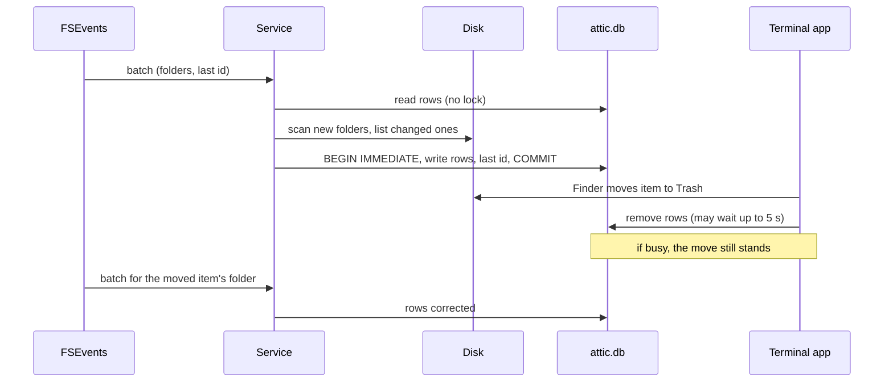
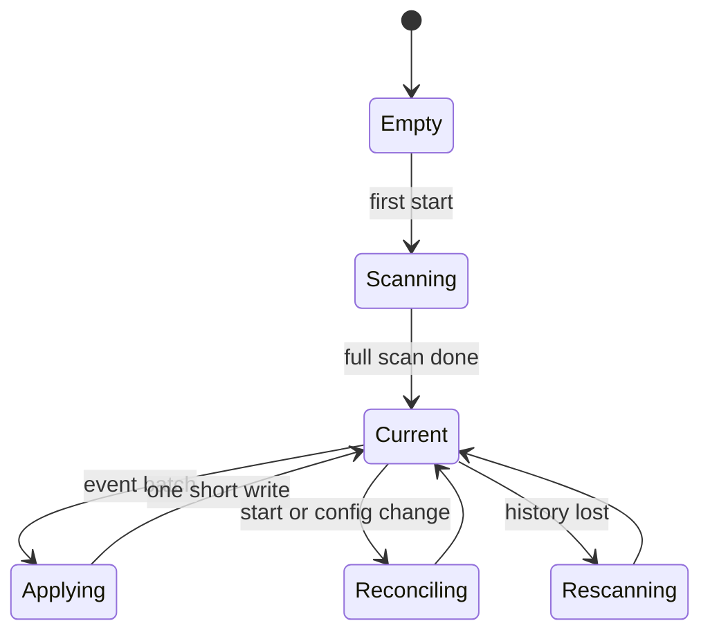

# ADR-001: One store, kept current from FSEvents

Status: Accepted (2026-10-31)

## Context

attic must show a home folder's sizes instantly and stay current without
rescanning a disk of about a million entries. The terminal app and the
background service run as separate processes and both write: the service as
the disk changes, the app when it moves something to the Trash.

## Decision

- One SQLite database (`attic.db`, WAL). One row per folder and per file at or
  above `min_file_size`; a folder's `size` and `files` cover everything below
  it. Every write (`replace_subtree`, `remove_subtree`, `put_entry`) moves the
  totals of all folders above by the difference, so no write ever re-sums a
  tree. Paths are raw bytes; descendants are a byte range, never `LIKE`.
- The service applies FSEvents batches. It reads the disk first (full scans of
  new folders, one-level rescans of changed ones) and then writes everything
  in one short `BEGIN IMMEDIATE` transaction, so a long scan never holds the
  lock the app needs. Changes to one folder in a batch merge, a subtree change
  winning.
- A hard-linked file counts `allocated / nlink` in each link's folder, the same
  in a full scan and a one-level rescan, so totals never depend on walk order.
- On start and after a config change the service reconciles: scans roots
  without rows, drops rows of removed roots and new excludes, and rereads
  folders that were unreadable (Full Disk Access usually comes later).
- The app treats a successful move to the Trash as done even if it cannot
  update the store at that moment; the service corrects the rows from the
  event the move causes.

## Consequences

- Totals are exact as long as every write goes through the store's three
  writers; tests compare the store with a fresh scan after every event case.
- Between the read and the write of a batch the app may remove rows that the
  batch then writes back; the next event fixes them.
- One folder's hard links show half (or a third...) of the file each.

## Alternatives considered

- Rescanning periodically: simple, but costs a full walk every time.
- Scanning inside the transaction: simpler code, but a big new folder held the
  write lock past the app's 5 s busy timeout (found in review).
- Counting a hard link once, where first seen: totals then depended on walk
  order and one-level rescans double counted.
