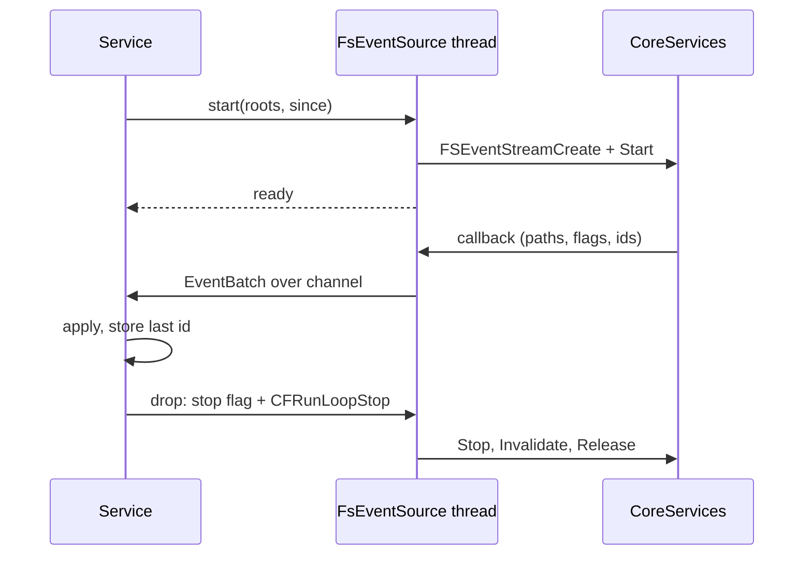
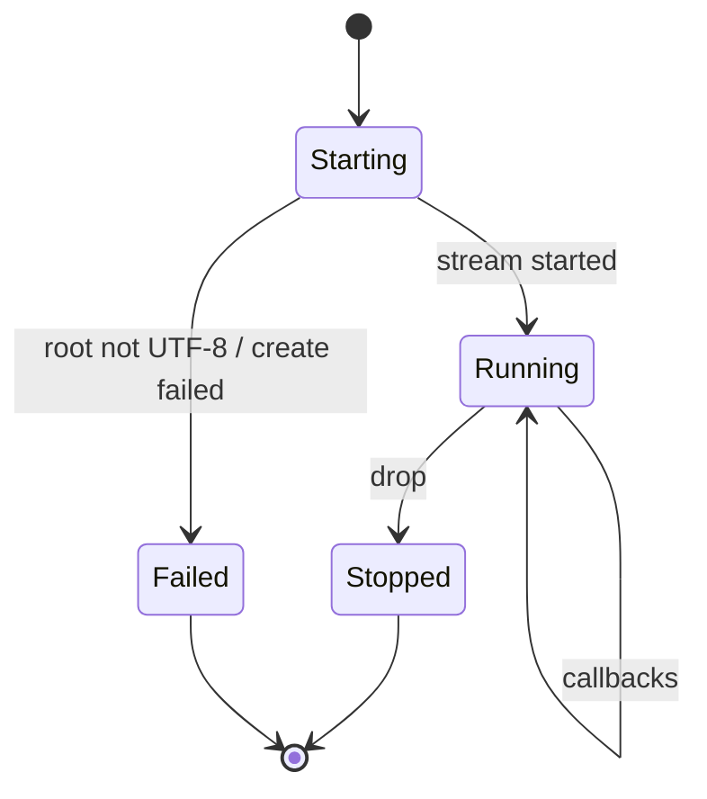

# ADR-002: FSEvents through our own FFI

Status: Accepted (2026-10-31)

## Context

The service needs folder-level change events with event ids, and must resume
from the last id after a restart so changes made while it was off are not
lost. `notify` does not expose ids or "since" replay. `fsevent-sys` does, but
is marked deprecated in favour of `objc2-core-services`, which fails the
build under `-D warnings`.

## Decision

`fsevents.rs` declares the six CoreServices functions it uses
(`FSEventStreamCreate`, schedule, start, stop, invalidate, release) over
`core-foundation-sys`, runs the stream on its own thread's run loop, and hands
each callback over a channel as one `EventBatch`. The last id is stored in the
database and passed back as `sinceWhen`. All FFI stays in that file.

## Consequences

- About forty lines of `unsafe` we own and test against the real API.
- The run loop wakes every 10 s to check its stop flag, in case a drop lands
  before the loop has started.

## Alternatives considered

- `fsevent-sys`: deprecated, fails the lint gate.
- `objc2-core-services`: maintained, but a much larger dependency for six calls.
- `notify`: no event ids, so no replay after a restart.
