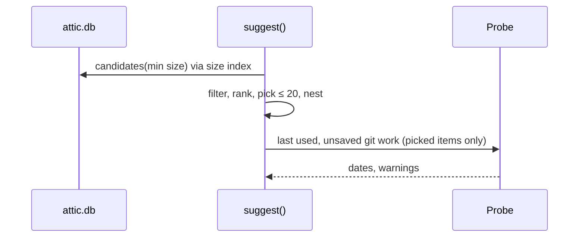
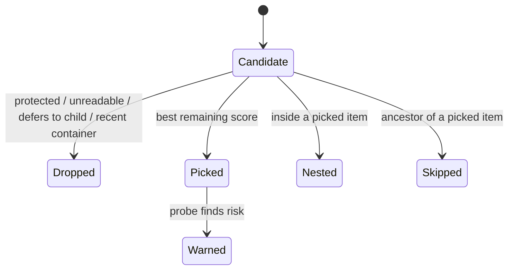
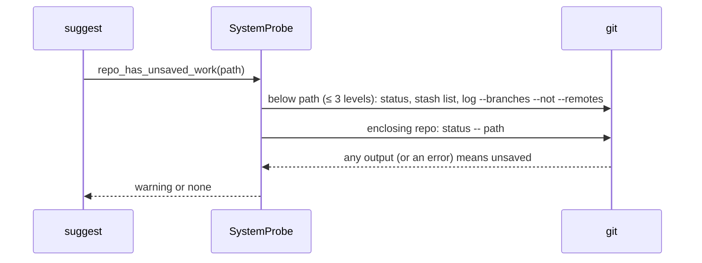
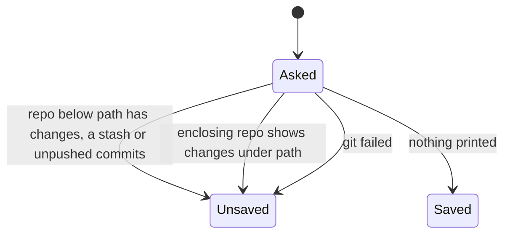

# ADR-003: How suggestions are picked and counted

Status: Accepted (2026-10-31)

## Context

Everything is fair game, but a list topped by `~/repos` or
`~/Library/Application Support` is useless, and "Could free" must not count
the same bytes twice. The service needs the same total for notifications
without spawning `mdls` and `git` every minute.

## Decision

- Candidates: folders and stored files of at least `min_file_size`, minus
  unreadable ones, the roots, home and the standard home folders (also never
  cleanable from the app). `~/.Trash` and attic's own folder are never
  scanned.
- A folder whose largest child holds 80% of it defers to the child. A folder
  used in the last week that contains other candidates is not suggested
  itself.
- Score `size * (1 + idle_days / 30)`. Walking by score, an item inside a
  chosen one is listed under it; an ancestor of a chosen one is skipped. The
  total sums the chosen items (at most 20).
- Probes run only after picking, so they never change which items are picked
  or the total; the service uses `NoProbe`, the app a cached `SystemProbe`.
  The newer of Spotlight's date and the newest change inside wins.

## Consequences

- The app's "Could free" and the notification's number agree.
- A recently used folder holding nothing big and old is still suggested, with
  a warning.

## Addendum: what the git probe counts

The probe warns when a repository at or up to three levels below the picked
path holds uncommitted changes, a stash, or commits on any local branch that
no remote has. An error from git counts as a warning: a wrong warning costs a
keypress, a missing one can cost work. Stashes and other branches were missed
at first (issues #4 and #5).

When the picked path sits inside a repository (a folder or file under
`~/code/webapp`), the probe also asks that repository for
`git status --porcelain -- <path>` and warns when it prints anything. Only
changed and untracked files count: tracked, clean files come back from git,
and ignored ones (`node_modules`, `target`) are what `rebuildable` is for.
Stashes and unpushed branches are about the whole repository, so they say
nothing about one folder and don't warn here (issue #6).

Cost, measured on synthetic repos in a temp folder (macOS, old and new
alternated, medians of 25 runs, 7 for the 40-repo case; the probe runs on
picked items only and the app caches it for 5 minutes). Every `git` call is a
process spawn, about 7 ms:

| Scenario | Old | New |
|---|---|---|
| **Typical:** project, 2k files, 10 branches, clean | 24 ms | 31 ms |
| **Typical:** same project, one untracked file | 27 ms | 26 ms |
| **Typical:** ignored `node_modules` (10k files) inside a repo | 15 ms (walk only, no check) | 21 ms |
| **Typical:** folder holding 5 clean projects | 205 ms | 240 ms |
| **Typical:** plain folder, 500 files, no repo | 0.4 ms | 0.4 ms |
| Stress: clean repo, 20k tracked files | 72 ms | 77 ms |
| Stress: dirty repo, 20k files (status exits early) | 69 ms | 69 ms |
| Stress: clean repo, 300 branches, 1000 commits | 22 ms | 38 ms |
| Stress: clean repo, 1000 branches, 300 commits | 22 ms | 63 ms |
| Stress: folder holding 40 clean repos | 2.1 s | 2.3 s |
| Stress: 100k files, no repo | 68 ms | 67 ms |
| Stress: folder inside a repo, 20k untracked files | no check | 26 ms |
| Stress: clean tracked folder inside a repo | no check | 14 ms |

The extra cost is `stash list` and `log --branches --not --remotes`; the
`rev-parse` that only the detached-HEAD fallback needs now runs lazily, which
took the clean-repo overhead from about 15 ms to 5 ms. A folder holding many
repos was already slow, and still is. The new times include the directory
walk the old probe also did (about 15 ms for 10k files).

Known gap: ignored files that can't be rebuilt (`.env`, a local database)
look like `node_modules` to git, so cleaning a whole repository doesn't warn
about them. If `~` itself is a repository, every path in it has an enclosing
repository, and untracked files there will warn.

## Alternatives considered

- Letting a later ancestor absorb chosen children: it made broad parents the
  top suggestions on a real home (found in review).
