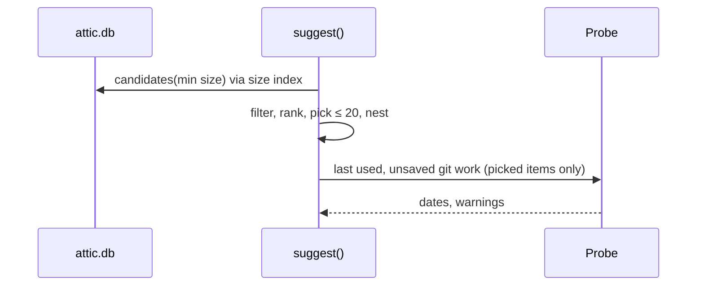
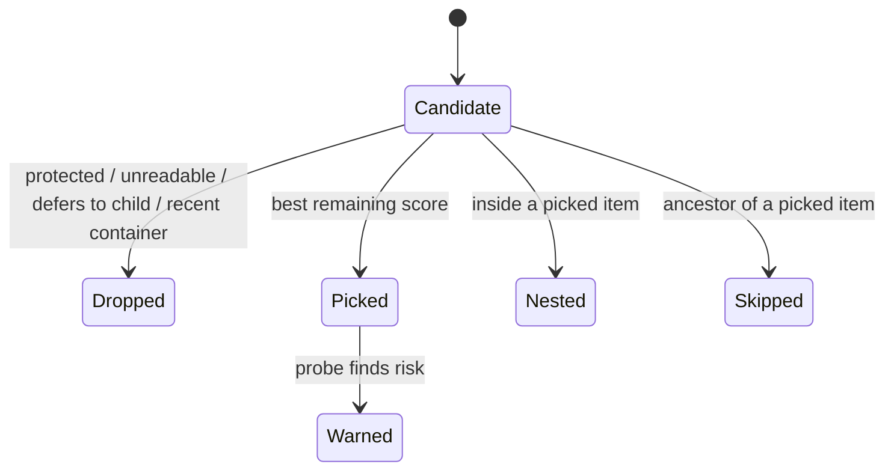

# ADR-003: How suggestions are picked and counted

Status: Accepted (2026-10-31)

## Context

Everything is fair game, but a list topped by `~/repos` or
`~/Library/Application Support` is useless, and "Could free" must not count
the same bytes twice. The service needs the same total for notifications
without spawning `mdls` and `git` every minute.

## Decision

- Candidates: folders and stored files of at least `min_file_size`, minus
  unreadable ones, the roots, home and the standard home folders (also never
  cleanable from the app). `~/.Trash` and attic's own folder are never
  scanned.
- A folder whose largest child holds 80% of it defers to the child. A folder
  used in the last week that contains other candidates is not suggested
  itself.
- Score `size * (1 + idle_days / 30)`. Walking by score, an item inside a
  chosen one is listed under it; an ancestor of a chosen one is skipped. The
  total sums the chosen items (at most 20).
- Probes run only after picking, so they never change which items are picked
  or the total; the service uses `NoProbe`, the app a cached `SystemProbe`.
  The newer of Spotlight's date and the newest change inside wins.

## Consequences

- The app's "Could free" and the notification's number agree.
- A recently used folder holding nothing big and old is still suggested, with
  a warning.

## Alternatives considered

- Letting a later ancestor absorb chosen children: it made broad parents the
  top suggestions on a real home (found in review).
