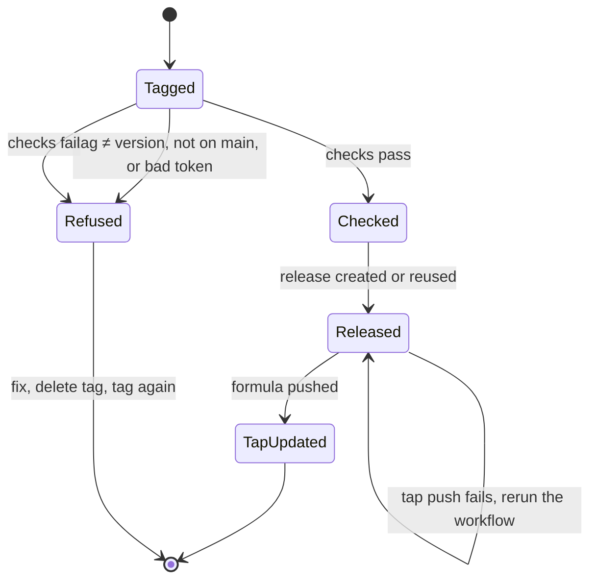

# ADR-004: Releases and the Homebrew tap

Status: Accepted (2026-11-24)

## Context

attic is going public. Until now the only Homebrew route was a tap on the
owner's disk that packed a tarball by hand, with paths nobody else has.
Anyone should be able to `brew install` it, every push should be checked,
and shipping a version should take one step that can't publish code CI
hasn't passed.

## Decision

- CI is one reusable workflow, `.github/workflows/checks.yml` (macOS runner,
  the `make ci` prerequisites). `ci.yml` calls it on pushes to `main` and on
  pull requests; `release.yml` calls it before releasing.
- A release starts when the owner pushes a tag `vX.Y.Z`. `scripts/check-tag.sh`
  refuses a tag that isn't exactly `v` plus the workspace version, a tag on a
  commit outside `main` is refused, and the job fails before anything is
  published if `HOMEBREW_TAP_TOKEN` is missing or can't read the tap.
- After the checks pass, the workflow creates the GitHub release, downloads
  GitHub's source tarball for the tag and hashes that download (never a local
  `git archive`, whose bytes differ).
- The formula's source is `packaging/homebrew/attic.rb.in` in this repo.
  `scripts/render-formula.sh` fills in the URL and `sha256`, refusing a hash
  that isn't 64 lowercase hex, and the workflow pushes the result to
  `sergiommarcial/homebrew-attic` as `github-actions[bot]`. The token is
  fine-grained, contents read/write on the tap only.
- Both steps are safe to rerun: an existing release is reused and an
  unchanged formula isn't committed.
- The checks include `scripts/check-formula.sh`: it renders the template
  into a throwaway tap and runs `brew style` and `brew audit --strict`, so a
  broken formula stops the release before users see it.
- Homebrew builds attic from source on the user's Mac. The tap's own CI runs
  a source build, `brew test` and `brew audit --strict` when the formula
  changes. Homebrew requires third-party taps to be trusted, so the install
  instructions start with `brew tap` and `brew trust`.

```mermaid
sequenceDiagram
    participant O as Owner
    participant GA as GitHub Actions
    participant R as GitHub Releases
    participant T as homebrew-attic
    participant B as User's brew
    O->>GA: push tag vX.Y.Z
    GA->>GA: check tag vs Cargo.toml, tag on main, token reads tap
    GA->>GA: checks.yml (make ci on macOS, formula style and audit)
    GA->>R: create release (or reuse it)
    GA->>R: download tag tarball, sha256
    GA->>T: push Formula/attic.rb
    Note over R,B: race: between release and tap push, brew still sees the old version; harmless
    T->>T: tap CI builds, tests, audits
    B->>T: brew update, brew upgrade attic
    B->>R: fetch tarball, build from source
```



## Consequences

- Installs compile attic, which takes a few minutes and pulls in Rust as a
  build dependency. Nothing unsigned or unnotarized is shipped.
- The formula changes with the code it installs: the `service` block sits in
  the same repo as `launchd.rs`, which it mirrors.
- The tap's `Formula/attic.rb` is generated; a hand edit there is overwritten
  by the next release.
- Users who upgrade can't be un-upgraded, which is why the tag check and the
  CI gate come before the release.
- `make ci` needs `actionlint` and `shellcheck` (`make install-tools`).

## Alternatives considered

- **Prebuilt bottles** with `brew test-bot`: fast installs, more CI to keep
  working. Can be added on top later.
- **homebrew-core:** needs an existing user base first.
- **`brew bump-formula-pr`:** opens a pull request per release that the owner
  then merges by hand. One more step for a one-person tap.
- **Formula kept by hand in the tap, CI editing `url` and `sha256`:** the tap
  would need a formula pointing at a release that doesn't exist yet, and the
  `service` block would drift from `launchd.rs`.
