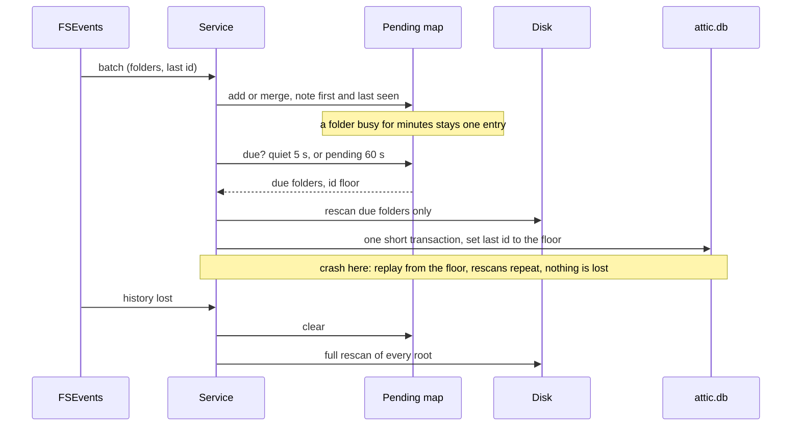
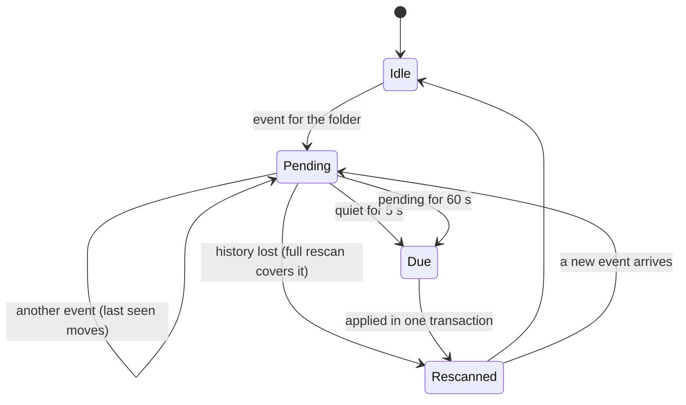

# ADR-005: Coalescing rescans of busy folders

Status: Accepted (2026-11-24)

## Context

The service rescans a folder every time FSEvents reports a change in it. A
Rust build rewrites thousands of files in `target/` over a few minutes, and
FSEvents reports the burst as a stream of small batches. Each batch costs a
rescan of the same folders, so the work grows with the number of events, not
with the size of the folder.

The service's own log shows it. In one session 1,004 of 1,055 slow rescans
were folders under a single project's `target/`, 424 of the 450 seconds spent
(the log line is [ADR-001](ADR-001-store-and-events.md)'s `apply_batch`
timing). The daemon sat between 40% and 99% of a core for hours, and the
terminal app hit "database is locked" while the service wrote.

`target/` folders can't simply be ignored. Stale build output is some of the
best cleanup attic can suggest, and a list of folder names to skip would
drift from what people actually have (`node_modules`, `.venv`, Gradle and
Xcode caches).

## Decision

The service keeps changes it hasn't applied yet and applies a folder only
when it has gone quiet or has waited long enough.

- A pending map holds, per folder, whether a subtree rescan is needed (a
  subtree change wins, as in ADR-001), when the folder was first and last
  seen, and the newest event id the stream had reached before the folder's
  first batch (its floor). Adding an event is O(1). If the clock moves back,
  a folder's first-seen time moves back with it, so it still comes due.
- A folder is due when nothing touched it for `QUIET` (5 seconds) or it has
  been pending for `MAX_WAIT` (60 seconds). A folder that never goes quiet is
  still rescanned once a minute; one that does is rescanned once, 5 seconds
  after the burst.
- Due folders go to `apply_batch` as one batch, unchanged. Folders that are
  due together merge the way they do inside a batch today. An ancestor and a
  descendant that come due at different times are applied in separate
  batches, so the descendant can be rescanned twice; the result is the same.
- `fsevents_last_id` records the lowest floor among the folders still
  pending, or the newest id seen when none are. A crash or restart replays
  from there, and a replayed event only repeats a rescan. The daemon stores
  the system's current event id the first time it starts, so a stored id
  always exists and every floor is real.
- The stored id can stay the same across applies, so each apply also bumps an
  `applied_batches` counter in its transaction, which the terminal app
  watches to know when to redraw.
- A batch with `history_lost` is applied at once and clears the pending map,
  because a full rescan covers everything in it; later floors start from its id. Changes in the config folder
  are applied at once too, so a config edit doesn't wait.
- `Service::step` waits for events no longer than the next due time, so a
  quiet machine still flushes. Time comes from the injected clock, so tests
  step through it without sleeping.

## Consequences

- A folder's rows can lag the disk by about 5 seconds once it goes quiet and
  by up to 60 seconds while it stays busy. The terminal app's own trash move
  already treats the move as done and relies on the service to fix the rows,
  so it now waits that long for the fix.
- The work per busy folder drops from one rescan per batch to at most one per
  minute. For the log above that is roughly two or three rescans for a
  two-minute build, not a thousand. We check this by reading the same log
  after the change.
- The service holds the pending map in memory only. Restarting it loses
  nothing that the replay from the stored id doesn't recover.
- Event ids are not tracked per event. The floor is coarser than strictly
  needed, so a restart can repeat some rescans. That is cheaper than keeping
  an id per folder.
- This does not explain every long scan. A full rescan of the home folder
  after lost events is a separate cost, and the service now logs when it
  starts one. If that turns out to be frequent it needs its own decision.

## Alternatives considered

- **Ignore known build folders** (`target/`, `node_modules`, ...): removes
  attic's best suggestions and needs a list that keeps growing.
- **Longer FSEvents latency:** one setting, no new state. But every folder
  lags by that long, and how FSEvents delivers under constant churn is out of
  our hands, so the cap on rescans isn't guaranteed.
- **Skip the rescan when the folder looks unchanged:** the cost is the
  `lstat` calls themselves, so checking first doesn't save them.
- **A CPU budget:** throttle the whole service to a share of a core. Simple to
  say, but the lag becomes unpredictable and a quiet folder can wait behind a
  busy one.
