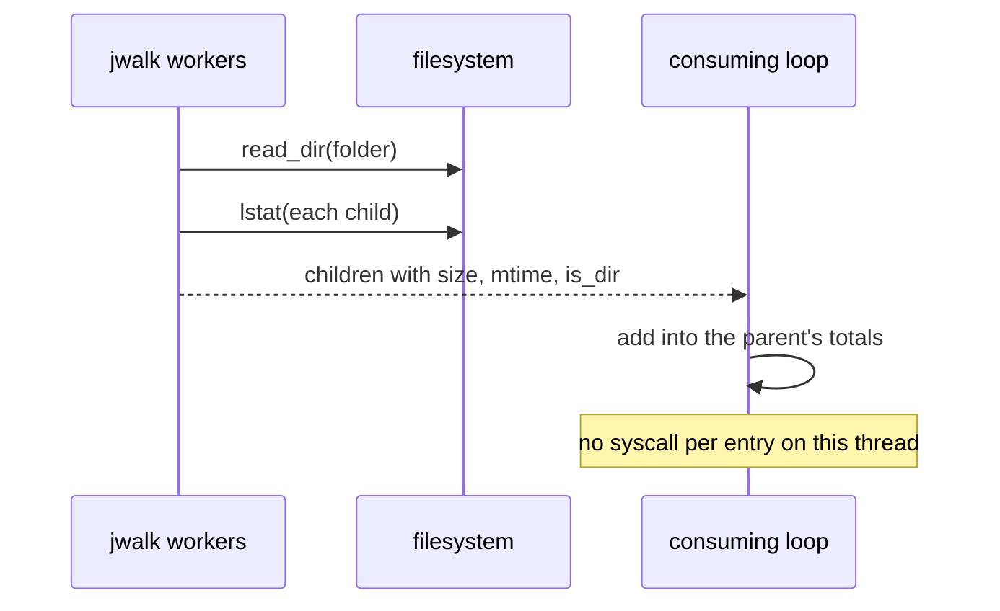
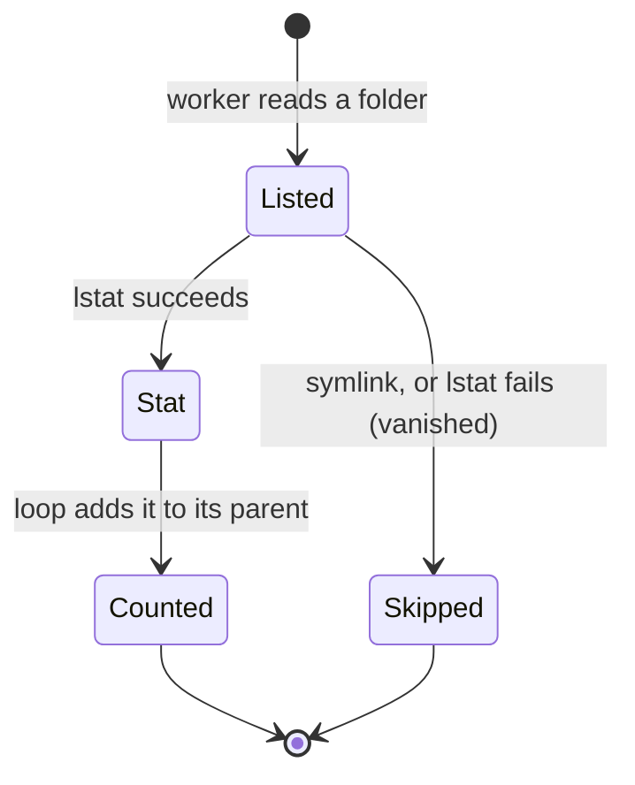

# ADR-006: Reading file metadata on the walker's worker threads

Status: Accepted (2026-11-25)

## Context

A scan walks a home folder with jwalk, which lists folders in parallel, and
then asked the filesystem for each entry's size and time (`lstat`) in the
loop that consumes the walk. That loop is one thread. A profile of repeated
scans of a 146,000-file tree (macOS `sample`) put 83% of that thread's time
in `lstat`, and about 5% in the path hashing around it. The workers listed
folders quickly and then waited for the one thread that was stat-ing.

Measured, warm cache: a bare walk took 92 ms, the walk with `lstat` on the
consuming thread 279 ms, and the walk with `lstat` on the workers 138 ms.

## Decision

`scan_with_progress` reads `lstat` inside jwalk's `process_read_dir`
callback, which runs on the worker threads, and stores the three things the
scan needs (is it a folder, its share of the disk, its mtime) as the entry's
client state. The consuming loop only accumulates.

- The root is nobody's child, so it never passes through the callback; the
  loop reads it itself.
- An entry whose `lstat` fails (it vanished) has no state and is skipped, as
  before. Symlinks get no `lstat` and are skipped, as before.
- The callback stats the entries of one folder one after another. That is
  enough: the workers run many folders at once.

## Consequences

Measured on synthetic trees in a temp folder (macOS, 10 cores, warm cache,
old and new alternated, medians of 15):

| Scan | Old | New |
|---|---|---|
| **Typical:** project, 3k files | 4.4 ms | 2.7 ms |
| **Typical:** home-like tree, 146k files | 329 ms | 158 ms |
| Stress: same tree, every file a row | 342 ms | 162 ms |
| Stress: 400 folders, 8k files | 20 ms | 10 ms |
| Stress: one folder with 100k files | 319 ms | 315 ms |

- Wall time roughly halves for ordinary trees. CPU time does not drop: it
  rises by about 20% (1.0 s to 1.2 s on the home-like tree), probably the
  ordered iterator waiting on workers. The service runs at `Nice 10` with low
  priority I/O, so the extra cores are used when nothing else wants them.
- A single huge folder gains nothing. Its `lstat` calls don't scale across
  threads inside one APFS directory. Trying rayon's `par_iter_mut` in the
  callback left it at 274 ms, so the extra dependency was dropped.
- A first scan on a cold disk is more I/O-bound than these runs, so expect a
  smaller gain there. Not measured: the benchmark rules out the real disk.
- The profile also showed the per-entry `HashMap<PathBuf, Dir>` costing about
  5% of the consuming thread. It stays for now; it's worth revisiting only if
  a later profile shows it.

## Alternatives considered

- Parallel `lstat` inside each folder with rayon: no gain on the folder that
  would need it, and a new direct dependency.
- Replacing the path-keyed map with a stack of folder accumulators by depth:
  relies on jwalk's yield order and addresses 5%, not 83%.
- Leaving the loop alone: a first scan is the slowest thing attic does.
